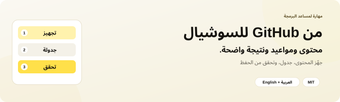
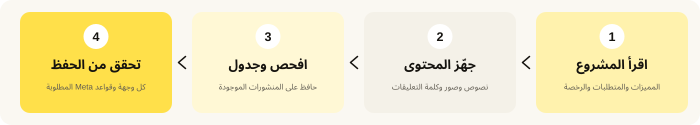

<div dir="rtl">

<p align="center"></p>

<p align="center"><a href="README.md"><b>Read in English</b></a> · <a href="#install">التثبيت</a> · <a href="#first-use">جرّبها</a> · <a href="#questions">أسئلة</a> · <a href="#share">المشاركة</a></p>

<p align="center"><a href="LICENSE"></a> <a href="docs/agent-installation.ar.md"></a> </p>

## 👋 ما هي GitHub Social Launch؟

مشروعك موجود على GitHub، وتريد تعريف الناس به. تحتاج نصوصًا وصورًا ومواعيد، وتتأكد أن كلمة التعليقات ترسل رابط المشروع الصحيح.

**GitHub Social Launch تعطي مساعد الذكاء الاصطناعي طريقة واضحة لتجهيز الإعلان وإكمال جدولة السوشيال التي تسمح بها.**

1. **يقرأ المشروع:** يثبت المميزات والمتطلبات والرخصة الفعلية.
2. **يجهّز النصوص والصور:** بنفس البراند وكلمة التعليقات.
3. **يفحص الجدولة ثم يضيف الناقص:** يحافظ على المنشورات الموجودة ويتجنب التكرار.
4. **يتحقق مما حُفظ:** يفحص كل وجهة وقواعد رسائل Meta المطلوبة.

<p align="center"></p>

**المهارة** مجلد تعليمات لمساعدك. ليست تطبيق جدولة مستقلًا أو إضافة متصفح، ولا خدمة تربط حساباتك. تساعد المساعد على استخدام أدواته وصلاحياته المتاحة بدقة.

### ماذا تغطي؟

| الجزء | ما يفعله المساعد |
| --- | --- |
| 📖 حقائق المشروع | يقرأ README والنسخة العربية إن وجدت والإصدار الأحدث وLICENSE قبل الادعاءات. |
| ✍️ النصوص | يجهّز X وThreads وفيسبوك ولينكدإن وردًا بالرابط، ونسخة إنستجرام عند اختياره. |
| 🎨 التصاميم | يستخدم الصور المعتمدة المناسبة أو ينشئ المطلوب بألوانك. |
| 📅 أربع وجهات | صفحة فيسبوك، وإنستجرام المرتبط، وبروفايل لينكدإن، وصفحة الشركة على لينكدإن. |
| 🔄 الجداول الموجودة | يفحص القوائم الحقيقية ويحافظ على المنشورات ويضيف القنوات الناقصة فقط. |
| 💬 تسليم الرابط | يضبط قواعد Meta الأصلية للتعليقات والرسائل المسموح بها عند توفرها، ويتحقق من القناتين. |
| ✅ التحقق | يفتح ما حُفظ ويعرض الحالة الحقيقية لكل وجهة. |

الإيقاع المفضّل **مشروع واحد يوميًا لكل وجهة مختارة**، Meta حوالي **20:00** ولينكدإن حوالي **10:30**، **بتوقيتك أنت**. طلبك الحالي له الأولوية. هذه تفضيلات عمل وليست ادعاءً بأنها أفضل أوقات التفاعل.

<a id="install"></a>

## 📥 التثبيت — خطوة بخطوة

**تحتاج إلى:** مساعد يقرأ الملفات. الجدولة الفعلية تحتاج أدوات متصفح أو جدولة مدعومة وصلاحية استخدام الحسابات. الصور الجديدة تحتاج أداة توليد؛ يمكن إعادة استخدام الصور النهائية الموجودة. المهارة لا تضيف أدوات أو بيانات دخول أو تكامل API.

### أسهل طريقة: اطلب من المساعد تثبيتها

1. افتح المساعد في جلسة تسمح بالتنزيل وحفظ الملفات.
2. انسخ وأرسل:

   ```text
   ثبّت github-social-launch من https://github.com/eyoussef-builds/github-social-launch.
   اقرأ الدليل وافحص المهارة أولًا. ثبّت مجلد skills/github-social-launch كاملًا
   في مكان المهارات الشخصية المدعوم للمساعد، وحافظ على أي نسخة معدّلة.
   وضّح لي أدوات تجهيز المحتوى والجدولة المتاحة لك.
   ```

3. اقرأ أي طلب إذن للتنزيل أو حفظ الملفات.
4. اسأل: «هل ترى github-social-launch؟ ماذا تحتاج قبل الجدولة؟».

### تفضّل النسخ بنفسك؟

1. [حمّل ZIP](https://github.com/eyoussef-builds/github-social-launch/archive/refs/heads/main.zip).
2. فك الضغط: انقر مرتين على الماك؛ وعلى Windows اضغط بالزر الأيمن ثم **Extract All…**.
3. افتح **skills** وستجد مجلد **github-social-launch** كاملًا.
4. انسخه إلى المكان الموجود في [دليل مساعدك](docs/agent-installation.ar.md).
5. أعد تحميل المهارات أو فتح المساعد عند الحاجة، ثم اطلب المهارة بالاسم.

يغطي الدليل **15 مساعدًا** بتثبيت أصلي أو طريقة قراءة تعليمات موضحة. قراءة الملفات لا تعني وجود أدوات متصفح أو صلاحية الجدولة؛ بدونها يمكن تجهيز النصوص والخطة فقط. مراجعة الوثائق مختلفة عن تجربة التنفيذ على كل مساعد.

<a id="first-use"></a>

## 🚀 أول إطلاق لك

### 1. أعطه رابط المشروع

في Codex، يمكنك البدء بالتجهيز فقط:

```text
استخدم $github-social-launch. جهّز إعلانًا لهذا المستودع: <repo URL>.
اقرأ README والإصدار والرخصة، وجهّز نصوصًا عربية وتصميمًا مناسبًا.
اعرض عليّ المواعيد المقترحة؛ لا تجدول شيئًا الآن.
```

استبدل `<repo URL>` برابط مشروعك. في Claude Code استخدم `/github-social-launch`، ولغيره طريقة الاستدعاء الخاصة به.

### 2. حدد الحسابات والمنطقة الزمنية

وضح صفحة فيسبوك وإنستجرام وبروفايل وصفحة لينكدإن المطلوبة، وتوقيتك والمتصفح الذي تريد استخدامه. يجب أن تكون الحسابات المسجّل دخولها متاحة فعلًا لبيئة المساعد. احفظ تفاصيل الحسابات والإدارة في ملفك الخاص، لا في المستودع العام.

يفحص المساعد قوائم الجدولة كلها. بروفايل لينكدإن وصفحة الشركة وجهتان منفصلتان. وجود بوست فيسبوك لا يثبت وجود نسخة إنستجرام.

### 3. وافق على الحملة المحددة

بعد المراجعة يمكنك قول:

```text
موافق. جدول الإعلانات على الوجهات الأربع التي حددناها، مشروعًا واحدًا يوميًا.
Meta الساعة 20:00 ولينكدإن الساعة 10:30 بتوقيتي. حافظ على المنشورات الموجودة.
فعّل قواعد التعليقات والرسائل الأصلية المطابقة على فيسبوك وإنستجرام إن توفرت،
وتحقق من كل بوست وقاعدة بعد الحفظ.
```

طلب الجدولة الصريح يعطي الإذن المناسب؛ لا تحتاج تكرار الموافقة لكل خطوة روتينية. تجهيز النص وحده لا يأذن بالنشر أو الرسائل. «ضم إنستجرام وصفحة لينكدإن دائمًا» يحفظ تفضيلًا للحملات التي تطلبها لاحقًا، ولا يبدأ نشرًا بلا نهاية.

### 4. دعه يفحص ويجدول ويتحقق

يعيد استخدام العمل الصحيح ويضيف الوجهات الناقصة فقط، ويتأكد من الحساب والنص والصورة والتاريخ والوقت ثم يجدول بالأدوات الأصلية. إذا تأخر الحفظ أو تعطل، يفحص القائمة قبل الإعادة حتى لا ينشئ نسخة مكررة.

في قواعد Meta المطلوبة، يفرق بين التعليقات وكلمات الرسائل الواردة، ويثبت الكلمة والرابط، ويتحقق من Messenger وإنستجرام كلٍّ على حدة، ثم يفتح القاعدة المحفوظة. التوفر والنطاق حسب الحساب والواجهة الفعلية. لا يفترض أتمتة رسائل لينكدإن.

### 5. اقرأ النتيجة

تستلم جدولًا لكل مشروع ووجهة، بالتاريخ والوقت والمنطقة الزمنية والحالة. **المسودة** تظل مسودة، و**مجدول وتم التحقق منه** يعني مراجعة القائمة المحفوظة، و**منشور وتم التحقق منه** يعني فحص بوست حي. تفعيل قاعدة الرسائل مختلف عن اختبار وصول رسالة فعلًا.

في **مثال مخترع** لمشروعين على أربع وجهات، الاكتمال يعني **8 إدخالات وجهات تم التحقق منها**، وليس ضغطتين في نافذة النشر. إذا كان فيسبوك موجودًا، أضف إنستجرام فقط. وإذا شغل منشور قديم اليوم المطلوب، حافظ عليه واستخدم اليوم التالي المسموح أو احسم تعارض الفترة المحددة.

## 🔒 الخصوصية في دقيقة

- المستودع تعليمات وقوالب فارغة وصور عامة، دون حسابات حقيقية أو أدلة حملات.
- بيانات الحسابات والجداول والمتصفح والصور الإثباتية والمستلمين تظل خاصة.
- الجدولة ترسل النص والصورة المعتمدين للمنصة. تفعيل قاعدة تعليقات مأذون بها قد يرسل ردودًا مستقبلية وفقها.
- تسري إعدادات المساعد وأداة الصور والمنصات على المدخلات؛ لا تحتاج تصدير ملفات الدخول أو Tokens.

اقرأ [دليل الخصوصية](docs/privacy.ar.md).

<a id="questions"></a>

## ❓ أسئلة وأجوبة

<details><summary><b>هل هي مجانية؟</b></summary>

مجانية ومفتوحة المصدر بترخيص MIT، بما فيه الاستخدام التجاري مع إبقاء إشعار الرخصة. يظل للمساعد والنموذج وأدوات الصور والخدمات تكاليفها. المهارة لا تشتري اشتراكات ولا تنشئ إعلانات مدفوعة.

</details>

<details><summary><b>هل تثبيتها يربط حساباتي؟</b></summary>

لا. استخدم متصفحك المسجّل دخوله أو أداة متصلة مسموحًا بها ومتاحة للمساعد. المهارة لا تحتوي بيانات دخول ولا تمنح صلاحيات.

</details>

<details><summary><b>هل ستنشر كل يوم للأبد؟</b></summary>

لا. تجدول القائمة المحددة التي طلبتها باستخدام قوائم المنصات الأصلية. لا تنشئ مهمة مساعد متكررة أو مراقبًا. التفضيلات المحفوظة تُستخدم عند طلب حملة أخرى.

</details>

<details><summary><b>هل كل الحسابات تدعم رسائل الكلمات؟</b></summary>

لا يوجد ضمان. تفحص القالب ونطاق التعليقات والقنوات المتاحة. إذا لم تتوفر، تجهز ردًا يدويًا وتوضح النقص. ردود لينكدإن يدوية ما لم تُثبت آلية مدعومة ومأذون بها.

</details>

<details><summary><b>هل تكمل دون تكرار البوستات؟</b></summary>

تستخدم سجلًا خاصًا وتطابقه مع القوائم الحقيقية قبل الإضافة. السجل يساعد، لكن قائمة المنصة هي إثبات وجود المنشور. الحفظ غير المؤكد يُفحص قبل الإعادة.

</details>

<details><summary><b>هل أستخدم ألواني ولغتي؟</b></summary>

نعم. الافتراضي نصوص مصرية وتصميم كريمي وأصفر وأسود وقلوب صفراء 💛. جمهورك ولغتك وألوانك ومواعيدك وكلمتك الصريحة الحالية لها الأولوية.

</details>

<details><summary><b>كيف أحدّثها أو أحذفها؟</b></summary>

قارن التنزيل الجديد بالمثبت واحفظ تعديلاتك وملفك الخاص. للحذف أزل مجلد المهارة المثبّت فقط. حذف المهارة لا يلغي منشورات مجدولة أو قواعد رسائل موجودة على المنصات. راجع [حل المشكلات](docs/agent-installation.ar.md#حل-المشكلات).

</details>

<a id="share"></a>

## 🖼️ شارك المهارة

[إنفوجرافيك إنجليزي](docs/images/infographic-en.png) · [إنفوجرافيك عربي](docs/images/infographic-ar.png) · [تصميم فيسبوك](docs/images/facebook-post-ar.png) · [نصوص السوشيال](docs/social-posts.ar.md) · [نص إنستجرام](docs/instagram-post.ar.md) · [نصوص مشاركة باللغتين](docs/share.md)

<p align="center"><a href="docs/images/infographic-en.png"></a> <a href="docs/images/infographic-ar.png"></a></p>

<p align="center"><a href="docs/images/facebook-post-ar.png"></a></p>

## 🛠️ ماذا يوجد داخلها؟

```text
skills/github-social-launch/
  SKILL.md       طريقة الحملة وحدود الإذن
  references/    المحتوى والتقويم والجدولة وقواعد Meta والتحقق
  assets/        قوالب فارغة لملف خاص وسجل الحملة
  agents/        بيانات Codex
docs/            أدلة التثبيت والخصوصية باللغتين والصور العامة
```

المهارة تعليمات فقط؛ لا تضم API جدولة أو إضافة متصفح أو برنامج نشر أو قاعدة حسابات. تُكتشف الواجهة وقت التنفيذ ولا تُنشر حالة العمل أو بيانات الدخول معها. اقرأ [أمثلة المطابقة المخترعة](skills/github-social-launch/references/calendar-and-state.md) و[دليل التحقق](skills/github-social-launch/references/verification-and-privacy.md) لفهم الفروق المهمة.

## 🤝 الدعم

[افتح بلاغًا](https://github.com/eyoussef-builds/github-social-launch/issues) بالعربية أو الإنجليزية بمثال مخترع، دون رسائل أو حسابات أو مفاتيح حقيقية. للأمور الخاصة: [hello@eyoussef.me](mailto:hello@eyoussef.me).

**إعداد [eyoussef-builds](https://github.com/eyoussef-builds)** · [hello@eyoussef.me](mailto:hello@eyoussef.me) · [eyoussef.me](https://eyoussef.me) · [MIT](LICENSE)

</div>
