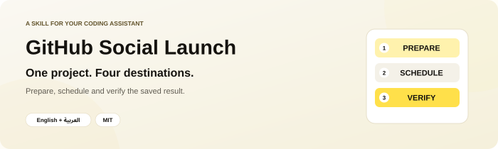
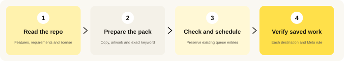
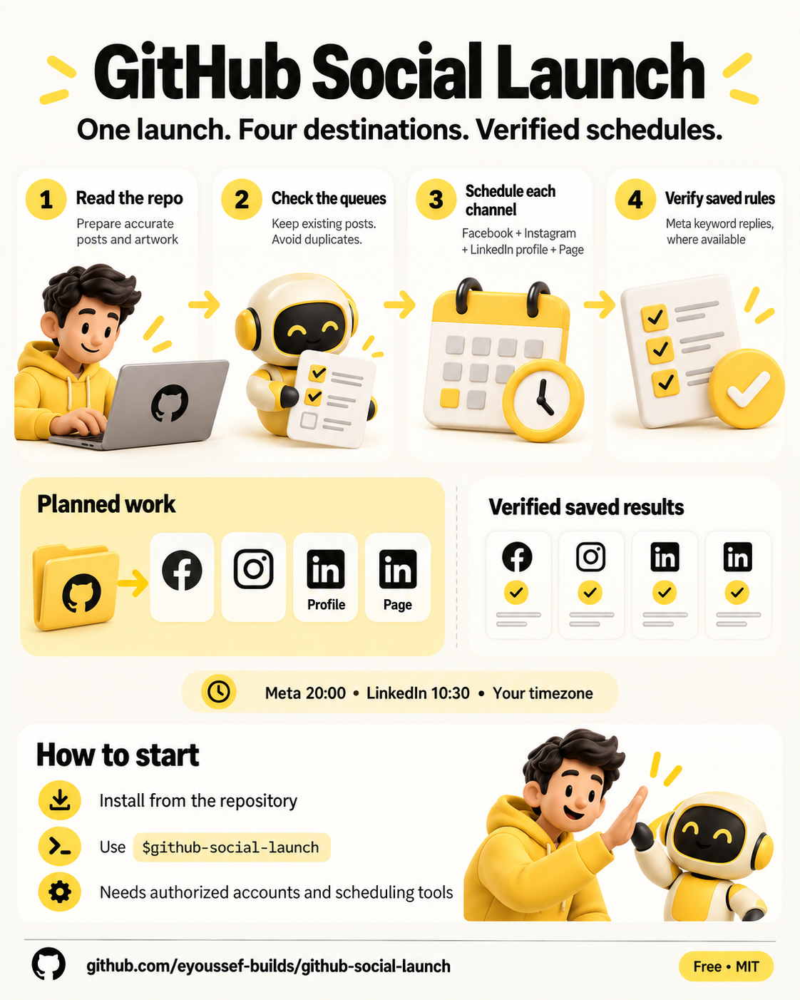
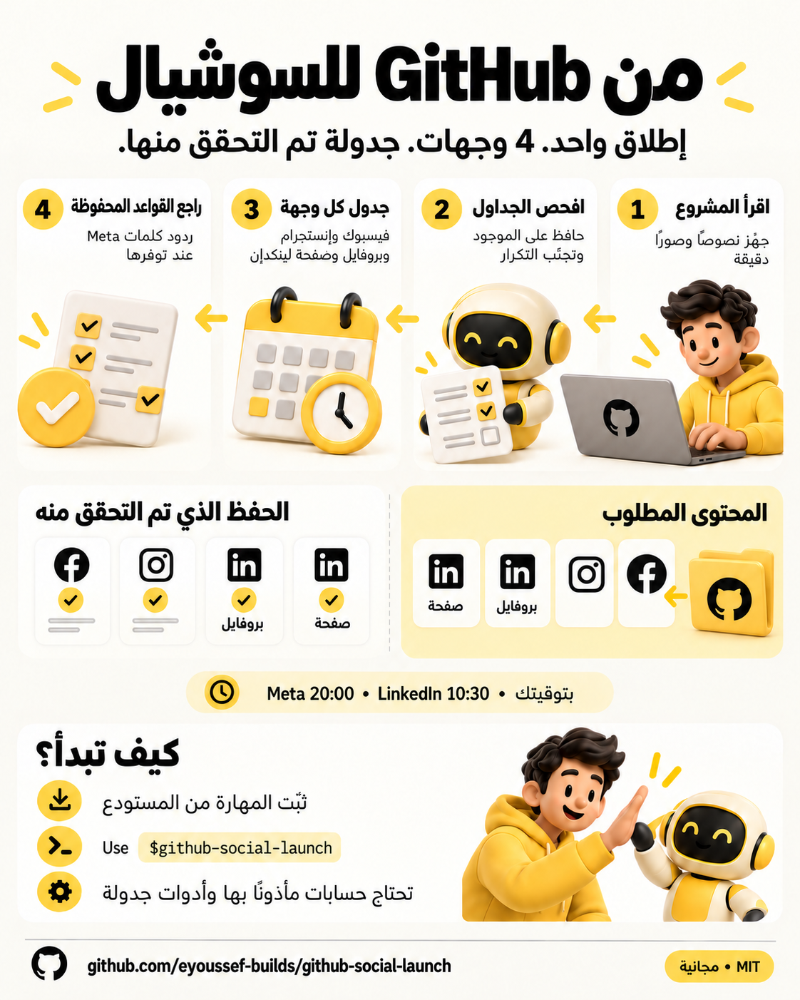
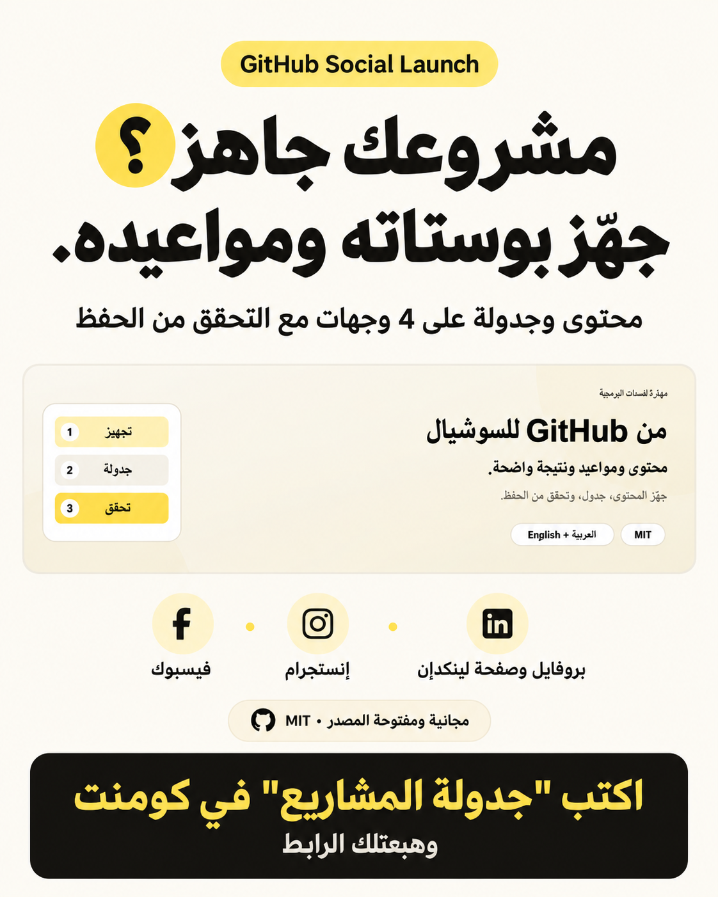

<p align="center"></p>

<p align="center"><a href="README.ar.md"><b>اقرأ الدليل بالعربية</b></a> · <a href="#install">Install</a> · <a href="#first-use">Try it</a> · <a href="#questions">Questions</a> · <a href="#share">Share</a></p>

<p align="center"><a href="LICENSE"></a> <a href="docs/agent-installation.md"></a> </p>

## 👋 What is GitHub Social Launch?

Your project is on GitHub. Now you want to tell people about it: write posts, attach the right design, choose dates and make sure the comment keyword sends the right link.

**GitHub Social Launch gives your AI assistant a repeatable way to prepare that announcement and complete the social scheduling you authorize.**

1. **Read the project:** establish its real features, requirements and license.
2. **Prepare the posts and artwork:** keep the wording, brand and keyword consistent.
3. **Check existing queues, then schedule:** preserve existing posts and add only missing work.
4. **Verify what saved:** inspect each destination and the requested SuperMod comment and incoming-message workflows, when connected.

<p align="center"></p>

A **skill** is a folder of instructions for your AI assistant. This is not a standalone scheduler, browser extension or a service that connects your accounts. It helps an assistant use its available authorized tools carefully.

### What does it cover?

| Part | What the assistant does |
| --- | --- |
| 📖 Repo facts | Reads README, Arabic README if present, latest release and LICENSE before making claims. |
| ✍️ Platform copy | Prepares Arabic X/Threads, Facebook, LinkedIn and reply blocks, plus an Instagram adaptation when selected. |
| 🎨 Designs | Reuses suitable approved artwork or creates requested images in your brand. |
| 📅 Four destination roles | Facebook Page, connected Instagram, LinkedIn personal profile and LinkedIn organization Page. |
| 🔄 Existing schedules | Checks live queues, preserves other content and adds missing channels without replaying completed work. |
| 💬 Keyword delivery | Uses connected SuperMod for comment and incoming-message keywords on Facebook/Messenger and Instagram; skips automation when disconnected. |
| ✅ Verification | Reopens saved queues/rules and reports the actual state for every destination. |

The preferred cadence is **one project per day per selected destination**, Meta around **20:00** and LinkedIn around **10:30**, in **your timezone**. Your requested dates and brand take precedence. These are workflow defaults, not claims about the best engagement times.

<a id="install"></a>

## 📥 Install it — step by step

**You need:** an assistant that can read files. Actual scheduling needs supported browser/scheduling tools and permission to use the social accounts. New artwork needs image generation; existing final images can be reused. The skill does not provide tools, credentials or an API integration.

### Easiest: let your assistant install it

1. Open your assistant in a session that can download/save files.
2. Copy and send:

   ```text
   Install github-social-launch from https://github.com/eyoussef-builds/github-social-launch.
   Read the installation guide and inspect the skill first. Install the complete
   skills/github-social-launch folder in this agent's supported personal skill directory.
   Preserve any customized copy. Tell me which preparation and scheduling tools you have.
   ```

3. Read any download/file permission request.
4. Check it appeared: “Can you see github-social-launch? What do you need before scheduling?”

### Prefer copying it yourself?

1. [Download ZIP](https://github.com/eyoussef-builds/github-social-launch/archive/refs/heads/main.zip).
2. Unzip it: double-click on Mac; on Windows right-click → **Extract All…**.
3. Open **skills** and find the complete **github-social-launch** folder.
4. Copy it to the location in [your agent's guide](docs/agent-installation.md).
5. Reload/reopen the agent if needed, then ask for the skill by name.

The guide covers **15 agents**, with native installation or clearly labeled instruction-reading adaptations. File support does not imply that an agent has browser tools or can schedule on your accounts. Without them, it can prepare copy and a plan. Documentation verification is separate from testing every harness.

<a id="first-use"></a>

## 🚀 Your first launch

### 1. Give it a repository

In Codex, start with a draft-only request:

```text
Use $github-social-launch. Prepare an announcement for this GitHub repo: <repo URL>.
Read its README, release and license. Prepare Arabic posts and suitable artwork.
Show me the proposed dates; do not schedule anything yet.
```

Replace `<repo URL>` with your project. In Claude Code use `/github-social-launch`; other agents have their own invocation controls.

### 2. Identify your accounts and timezone

Tell it which Facebook Page, Instagram, LinkedIn profile and LinkedIn Page to use, your timezone and the browser you want it to operate. Your signed-in accounts must actually be available to that environment. Keep account/admin details in your private installed profile rather than a public repository.

The assistant checks all selected queues. A LinkedIn personal profile and company Page are separate destinations. A Facebook entry does not prove that Instagram also has the post.

### 3. Approve the concrete campaign

After reviewing, you can say:

```text
Approved. Schedule these announcements on the four destinations we identified,
one project per day: Meta at 20:00 and LinkedIn at 10:30 in my timezone.
Preserve existing posts. For every repo, use connected SuperMod for comment and
incoming-message keyword rules on Facebook/Messenger and Instagram. If SuperMod
is not connected, skip automation and report it. Verify every saved post and workflow.
```

A direct request to schedule already supplies the relevant authorization; routine steps do not need repeated approval. Preparing copy alone does not authorize publication or messaging. “Always include Instagram and the LinkedIn Page” can save a preference for future requested campaigns, not start indefinite posting.

### 4. Let it check, schedule and verify

It reuses correct existing work, adds only missing destinations, checks the final actor/caption/image/date/time and submits through native scheduling. If a save times out, it checks the queue before retrying to avoid duplicates.

For each repo, it uses an existing authorized SuperMod connection for four cells: Facebook comment, Instagram comment, Messenger incoming message and Instagram incoming message. It checks canonical keywords plus reviewed Arabic spelling aliases across both triggers, confirms the exact link and reopens saved workflows. Without SuperMod, it skips automation, keeps scheduling authorized posts and reports the gap with manual reply copy. Partial connections produce partial coverage. It creates no native Meta keyword fallback. No LinkedIn DM automation is assumed.

**SuperMod is optional and separate.** It is not bundled with this MIT skill, and this repository makes no claim that SuperMod is open source or publicly available. Installing the skill does not connect, deploy or publish SuperMod. Keep your instance URL and account bindings in a private installed profile; enter secrets only in the service’s supported private controls.

### 5. Read the result

You get a table by project and destination, with explicit dates, times, timezone and status. A **draft** stays a draft; **scheduled verified** means the saved queue was checked; **published verified** means a live post was inspected. An enabled message rule is reported separately from actual message-delivery testing.

For an **invented example** of two repos across four destinations, completion means **8 verified destination entries**, not just two composer clicks. If Facebook was already scheduled, only Instagram needs adding. If an existing post occupies a requested day, preserve it and use the next permitted day or resolve a fixed-window conflict.

## 🔒 Privacy in one minute

- This repo contains reusable instructions, blank private-state templates and public artwork, not real accounts or campaign evidence.
- Actual account bindings, schedule records, browser details, screenshots and recipients stay private.
- Scheduling sends your approved text/images to the chosen platform. Enabling an authorized comment rule can send future replies under that rule.
- Your assistant, image tool and social platforms process their inputs under their own settings. No cookie/token export is needed.

Read the [privacy guide](docs/privacy.md).

<a id="questions"></a>

## ❓ Questions & answers

<details><summary><b>Is it free?</b></summary>

The skill is free and open source under MIT, including commercial use with the license notice retained. Your agent, model, image tools and services keep their own costs. This skill does not buy subscriptions or create paid ads.

</details>

<details><summary><b>Does installing it connect my social accounts?</b></summary>

No. Use the normal signed-in browser or authorized connector available to your assistant. The skill contains no login data and grants no access.

</details>

<details><summary><b>Will it post every day forever?</b></summary>

No. It schedules the finite list you requested using native platform queues. It does not create a recurring agent job or monitor. Standing preferences only apply when you request another campaign.

</details>

<details><summary><b>Does every account support keyword DMs?</b></summary>

No. Keyword automation requires an already connected, ready SuperMod instance for the intended accounts. If absent, automation is explicitly skipped; if only one channel is ready, only that coverage is configured. Existing native rules are preserved until a verified replacement is ready, and unrelated rules are left alone. LinkedIn replies remain manual unless a supported authorized mechanism is actually verified.

</details>

<details><summary><b>Can it resume without duplicating posts?</b></summary>

It uses a private ledger and reconciles live queues before submitting. Saved state helps, but the actual platform queue is what establishes a post exists. Ambiguous saves are checked before retrying.

</details>

<details><summary><b>Can I use my own brand and language?</b></summary>

Yes. Defaults are Egyptian Arabic copy, cream/yellow/ink graphics and yellow hearts 💛. Give your own audience, language, brand, dates or chosen keyword and the current request takes precedence.

</details>

<details><summary><b>How do I update or remove it?</b></summary>

Compare a new download with your installed folder and preserve changes and any private local profile. Remove only the installed skill folder to uninstall it. Removing the skill does not cancel existing scheduled posts, SuperMod workflows or native message rules. See [troubleshooting](docs/agent-installation.md#troubleshooting).

</details>

<a id="share"></a>

## 🖼️ Share this skill

[English infographic](docs/images/infographic-en.png) · [Arabic infographic](docs/images/infographic-ar.png) · [Facebook promo](docs/images/facebook-post-ar.png) · [Arabic social copy](docs/social-posts.ar.md) · [Instagram copy](docs/instagram-post.ar.md) · [Bilingual captions](docs/share.md)

<p align="center"><a href="docs/images/infographic-en.png"></a> <a href="docs/images/infographic-ar.png"></a></p>

<p align="center"><a href="docs/images/facebook-post-ar.png"></a></p>

## 🛠️ What is inside?

```text
skills/github-social-launch/
  SKILL.md       Campaign workflow and authorization boundaries
  references/    Content, calendar, native scheduling, SuperMod rules and verification
  assets/        Blank private profile and campaign-ledger templates
  agents/        Codex metadata
docs/            Bilingual installation/privacy guides and public artwork
```

This is an instruction-only skill. It has no bundled scheduler API, browser extension, executable posting helper or account database. Native controls are discovered during use; private state and credentials are not shipped with it. Read the [synthetic reconciliation scenarios](skills/github-social-launch/references/calendar-and-state.md) and [verification guide](skills/github-social-launch/references/verification-and-privacy.md) for its important distinctions.

## 🤝 Support

[Open an issue](https://github.com/eyoussef-builds/github-social-launch/issues) in English or Arabic with an invented example. Do not attach real inboxes, account IDs or credentials. For private matters: [hello@eyoussef.me](mailto:hello@eyoussef.me).

**Created by [eyoussef-builds](https://github.com/eyoussef-builds)** · [hello@eyoussef.me](mailto:hello@eyoussef.me) · [eyoussef.me](https://eyoussef.me) · [MIT](LICENSE)
